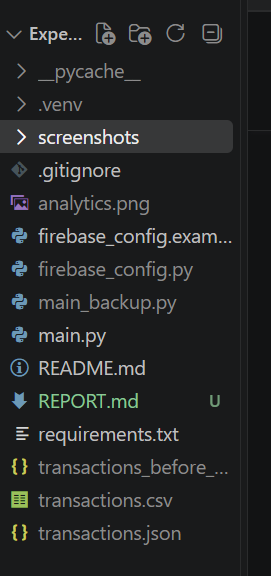
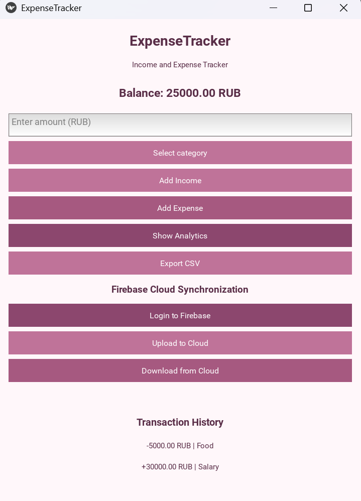
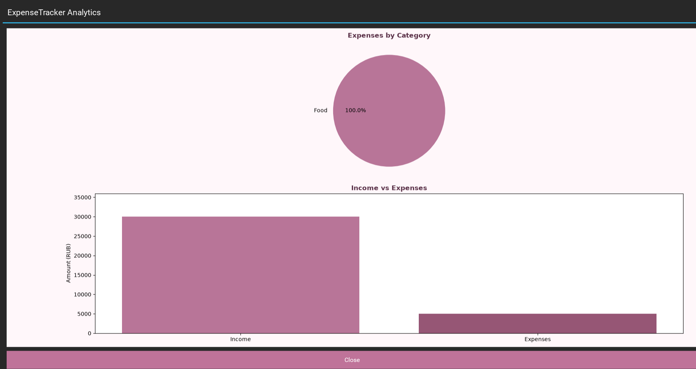
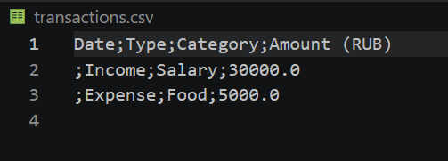
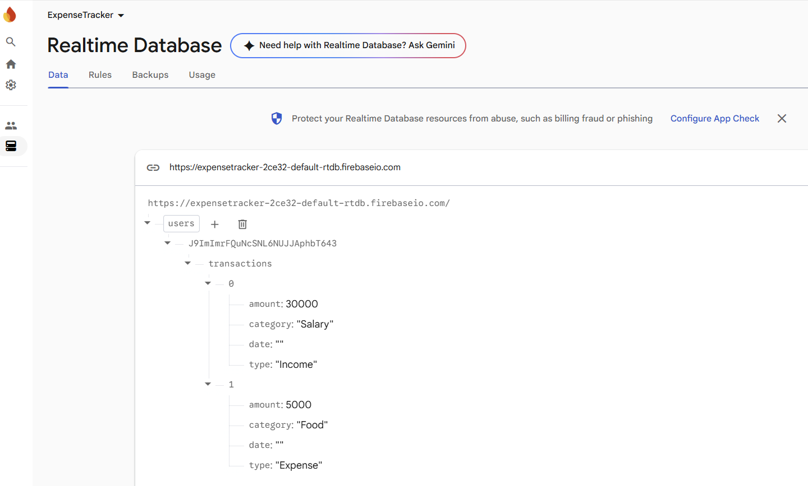
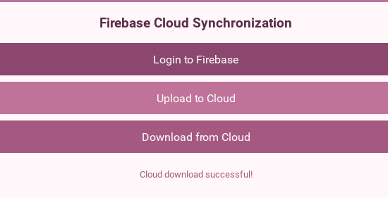

# Отчёт по домашнему заданию к лекции № 6

## Разработка мобильного приложения ExpenseTracker

### 1. Цель работы

Цель работы — разработать приложение ExpenseTracker на языке Python с использованием библиотеки Kivy, предназначенное для учёта личных доходов и расходов, визуализации финансовых данных и синхронизации информации с облачной базой Firebase.

### 2. Задачи работы

В ходе выполнения домашнего задания необходимо:

1. Разработать графический интерфейс приложения с использованием Kivy.
2. Реализовать добавление доходов и расходов с выбором категорий.
3. Обеспечить автоматический расчёт текущего баланса.
4. Организовать локальное сохранение финансовых операций и экспорт данных в CSV.
5. Добавить визуализацию финансовых данных с использованием Kivy Garden — Matplotlib.
6. Реализовать облачную синхронизацию через Firebase REST API.
7. Проверить работоспособность разработанного приложения.

### 3. Подготовка среды разработки

Для выполнения работы была использована среда разработки Visual Studio Code и язык программирования Python.

На первом этапе была создана папка проекта ExpenseTracker, после чего открыта в Visual Studio Code.

Для изоляции зависимостей проекта было создано виртуальное окружение `.venv`.

Команда создания виртуального окружения:

```powershell
py -m venv .venv
```

Для работы приложения были установлены необходимые библиотеки: Kivy, Matplotlib, Requests, Kivy Garden — Matplotlib, а также дополнительные зависимости.

Список основных библиотек был сохранён в файле `requirements.txt`, что позволяет устанавливать необходимые пакеты при запуске проекта на другом компьютере.

Основной программный код приложения размещён в файле `main.py`. Для описания проекта создан файл `README.md`.

### 4. Структура проекта

В проекте были организованы файлы программного кода, конфигурации и документации.

Основные файлы проекта:

- `main.py` — основной программный код приложения.
- `requirements.txt` — список необходимых библиотек.
- `README.md` — описание проекта и инструкция по запуску.
- `firebase_config.example.py` — пример настройки подключения к Firebase.
- `REPORT.md` — отчёт о выполнении домашнего задания.
- `screenshots/` — изображения, подтверждающие выполнение работы.

На рисунке 1 представлена структура проекта ExpenseTracker в среде Visual Studio Code.



*Рисунок 1 — Структура проекта ExpenseTracker в Visual Studio Code.*

**Вывод:** на подготовительном этапе была настроена среда разработки, установлены необходимые библиотеки и организована структура проекта для дальнейшей реализации приложения.

### 5. Разработка графического интерфейса приложения

Для создания графического интерфейса была использована библиотека Kivy. Основной код приложения реализован в файле `main.py`.

Интерфейс ExpenseTracker выполнен в розовой цветовой гамме. Для удобства пользователя элементы управления расположены последовательно, а содержимое окна можно прокручивать.

В главном окне приложения реализованы следующие элементы:

- Поле ввода суммы финансовой операции.
- Выбор категории дохода или расхода.
- Кнопка `Add Income` для добавления дохода.
- Кнопка `Add Expense` для добавления расхода.
- Отображение общей суммы доходов, расходов и текущего баланса.
- Кнопка `Show Analytics` для просмотра финансовых диаграмм.
- Кнопка `Export CSV` для экспорта операций.
- Кнопки `Login to Firebase`, `Upload to Cloud` и `Download from Cloud` для работы с облачной базой данных.
- Раздел `Transaction History` для просмотра истории операций.

При добавлении финансовой операции приложение сохраняет её данные и обновляет информацию о доходах, расходах и балансе.

На рисунке 2 представлен графический интерфейс разработанного приложения.


*Рисунок 2 — Главное окно приложения ExpenseTracker.*

**Вывод:** разработан графический интерфейс, позволяющий пользователю добавлять финансовые операции, просматривать историю транзакций, анализировать данные и управлять облачной синхронизацией.

### 6. Реализация учёта доходов и расходов

В приложении ExpenseTracker реализована возможность регистрации финансовых операций двух типов: доходов и расходов.

Для добавления операции пользователь вводит сумму в рублях, выбирает категорию и нажимает соответствующую кнопку `Add Income` или `Add Expense`.

Для доходов и расходов предусмотрены различные категории, например Salary, Food, Transport, Shopping и другие.

После добавления операции приложение сохраняет информацию о её типе, сумме, категории и дате. Все операции отображаются в разделе `Transaction History`.

Также реализован автоматический расчёт текущего баланса по формуле:

**Баланс = Общая сумма доходов − Общая сумма расходов.**

Для проверки работы приложения были добавлены две операции:

1. Доход в категории Salary — 30 000 рублей.
2. Расход в категории Food — 5 000 рублей.

В результате расчёта получен баланс:

**30 000 − 5 000 = 25 000 рублей.**

На рисунке 3 представлен результат учёта финансовых операций и автоматического расчёта баланса.



*Рисунок 3 — Отображение баланса и истории финансовых операций.*

**Вывод:** реализован учёт доходов и расходов с распределением по категориям. Проверка показала, что приложение корректно рассчитывает баланс и отображает сохранённые операции в истории.

### 7. Визуализация финансовых данных

В соответствии с заданием к лекции № 6 в приложение ExpenseTracker была добавлена визуализация финансовых данных с использованием библиотек Matplotlib и Kivy Garden — Matplotlib.

Для отображения графиков реализована кнопка `Show Analytics`. При её нажатии открывается окно аналитики, содержащее две диаграммы.

**Круговая диаграмма** показывает распределение расходов по категориям. Она позволяет определить, на какие категории приходится наибольшая часть расходов.

**Столбчатая диаграмма** отображает общие суммы доходов и расходов, что позволяет сравнить поступления и затраты пользователя.

Для интеграции графиков непосредственно в интерфейс Kivy использован компонент `FigureCanvasKivyAgg` из библиотеки `kivy_garden.matplotlib`.

В ходе тестирования были использованы следующие данные:

- Доходы — 30 000 рублей.
- Расходы — 5 000 рублей.
- Категория расходов — Food.

В результате круговая диаграмма показала, что 100% расходов относятся к категории Food. Столбчатая диаграмма отобразила превышение доходов над расходами.

На рисунке 4 представлены построенные диаграммы.



*Рисунок 4 — Круговая и столбчатая диаграммы в приложении ExpenseTracker.*

**Вывод:** реализована визуализация финансовых данных с использованием Kivy Garden — Matplotlib. Диаграммы отображаются непосредственно в приложении и позволяют анализировать структуру расходов и соотношение доходов и затрат.

### 8. Реализация экспорта финансовых операций в CSV

В приложении ExpenseTracker реализована возможность экспорта финансовых операций в файл формата CSV.

Для выполнения экспорта пользователь нажимает кнопку `Export CSV` в главном окне приложения.

После нажатия кнопки программа формирует файл `transactions.csv`, в котором сохраняются сведения о финансовых операциях.

Для каждой транзакции сохраняются следующие данные:

- Тип операции (Income или Expense).
- Категория операции.
- Сумма в рублях.
- Дата совершения операции.

Формат CSV позволяет просматривать и обрабатывать сохранённые данные в табличных редакторах, например Microsoft Excel.

В ходе проверки был выполнен экспорт ранее добавленных операций: дохода 30 000 рублей в категории Salary и расхода 5 000 рублей в категории Food.

На рисунке 5 представлено содержимое сформированного CSV-файла.



*Рисунок 5 — Содержимое файла transactions.csv с финансовыми операциями.*

**Вывод:** реализована функция экспорта финансовых операций в CSV. Полученный файл позволяет сохранять данные в табличном формате и использовать их для дальнейшего анализа.

### 9. Реализация облачной синхронизации через Firebase

Для хранения финансовых операций в облаке была использована платформа Firebase.

В ходе выполнения работы был создан проект Firebase и настроены два основных сервиса:

- **Firebase Authentication** — для авторизации пользователей.
- **Firebase Realtime Database** — для хранения финансовых операций в облачной базе данных.

Для взаимодействия приложения с Firebase использован REST API и библиотека Requests.

Параметры подключения к Firebase были вынесены в отдельный файл `firebase_config.py`. Для безопасности этот файл не включён в публичный репозиторий GitHub.

В интерфейсе ExpenseTracker реализованы три основные кнопки для работы с облачной базой:

1. `Login to Firebase` — авторизация пользователя.
2. `Upload to Cloud` — отправка локальных транзакций в Firebase Realtime Database.
3. `Download from Cloud` — восстановление транзакций из облачной базы.

Перед заменой данных приложение запрашивает подтверждение пользователя. При восстановлении транзакций предусмотрено создание резервной копии существующего локального файла.

После успешной авторизации пользователь может загружать финансовые операции в облако и восстанавливать их при необходимости.

На рисунке 6 представлена облачная база Firebase Realtime Database с сохранёнными финансовыми операциями.



*Рисунок 6 — Хранение финансовых операций в Firebase Realtime Database.*

**Вывод:** реализовано подключение приложения к Firebase с использованием REST API. Облачная синхронизация позволяет сохранять финансовые операции в удалённой базе данных и восстанавливать их при необходимости.

### 10. Проверка облачной синхронизации

После настройки Firebase была проведена проверка загрузки и восстановления финансовых операций.

Для проверки использовались две транзакции:

- Доход 30 000 рублей в категории Salary.
- Расход 5 000 рублей в категории Food.

Сначала была выполнена авторизация пользователя через кнопку `Login to Firebase`.

После успешной авторизации была нажата кнопка `Upload to Cloud`. Приложение запросило подтверждение отправки данных, после чего транзакции были сохранены в Firebase Realtime Database.

Наличие записей было проверено через Firebase Console.

Затем была проверена функция `Download from Cloud`, предназначенная для восстановления финансовых операций из облачной базы.

После восстановления данных приложение отобразило сохранённые транзакции в истории операций.

На рисунке 7 представлена проверка облачной синхронизации в приложении ExpenseTracker.



*Рисунок 7 — Проверка работы облачной синхронизации ExpenseTracker.*

**Вывод:** проверена возможность сохранения финансовых операций в Firebase и их последующего восстановления. Облачная синхронизация работает через REST API и позволяет получать ранее сохранённые данные.

### 11. Тестирование разработанного приложения

После завершения разработки было проведено тестирование основных функций ExpenseTracker.

Для проверки использовались тестовые финансовые операции: доход 30 000 рублей в категории Salary и расход 5 000 рублей в категории Food.

Результаты тестирования представлены в таблице 1.

**Таблица 1 — Результаты тестирования ExpenseTracker**

| № | Проверяемая функция | Полученный результат | Статус |
|---|---|---|---|
| 1 | Запуск приложения | Главное окно открывается | Успешно |
| 2 | Добавление дохода | Доход 30 000 RUB отображается в истории | Успешно |
| 3 | Добавление расхода | Расход 5 000 RUB отображается в истории | Успешно |
| 4 | Расчёт баланса | Баланс составляет 25 000 RUB | Успешно |
| 5 | Построение диаграмм | Круговая и столбчатая диаграммы отображаются | Успешно |
| 6 | Экспорт в CSV | Файл transactions.csv содержит две операции | Успешно |
| 7 | Авторизация Firebase | Пользователь успешно авторизован | Успешно |
| 8 | Загрузка в Firebase | Обе транзакции сохранены в Realtime Database | Успешно |
| 9 | Восстановление из Firebase | Отображено сообщение Cloud download successful! | Успешно |

В результате тестирования установлено, что основные функции приложения работают корректно.

При проверке экспорта было выявлено, что у двух тестовых операций не заполнены даты. При этом типы операций, категории и суммы сохранены правильно. Данный недостаток следует учитывать при дальнейшем совершенствовании приложения.

### 12. Заключение

В ходе выполнения домашнего задания к лекции № 6 было разработано приложение ExpenseTracker для учёта личных доходов и расходов на языке Python с использованием библиотеки Kivy.

В процессе работы была настроена среда разработки Visual Studio Code, создано виртуальное окружение Python и установлены необходимые библиотеки.

Реализован графический интерфейс приложения, позволяющий добавлять финансовые операции, выбирать категории, просматривать историю транзакций и автоматически рассчитывать текущий баланс.

Для анализа финансовых данных добавлены круговая и столбчатая диаграммы с использованием Kivy Garden — Matplotlib.

Также реализованы экспорт операций в CSV и облачная синхронизация через Firebase REST API. Проверена возможность сохранения транзакций в Firebase Realtime Database и их последующего восстановления.

По результатам тестирования основные функции приложения работают корректно. Все три дополнительных требования домашнего задания выполнены.

Разработанный проект размещён в репозитории GitHub вместе с программным кодом, описанием, инструкцией по запуску и отчётом о выполненной работе.

